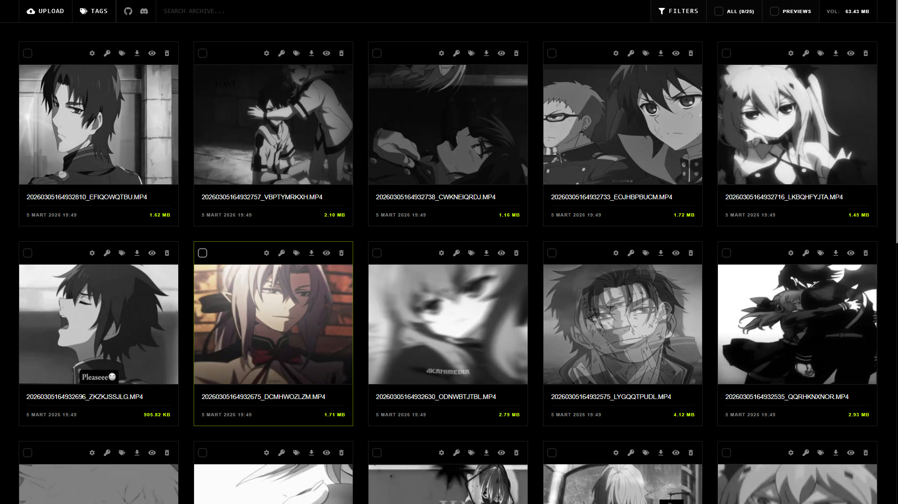
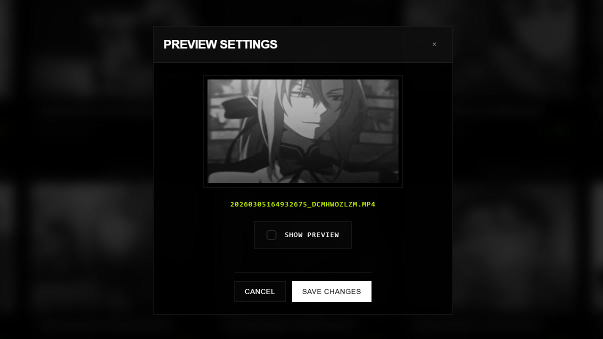
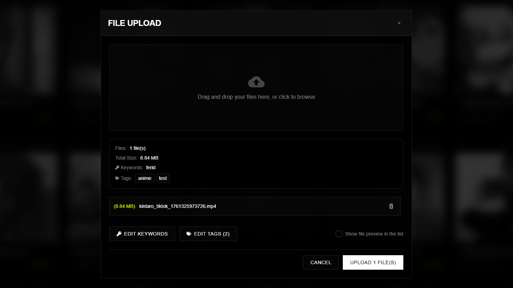
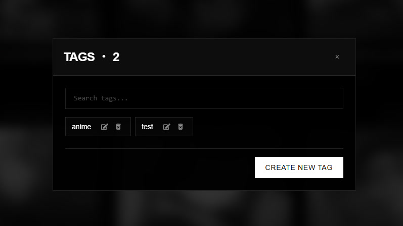

<a href="README.md">
  
</a>
<a href="README-TR.md">
  
</a>

  <br />
  <br />

<div align="center">
  
  <br />
  <br />

  <p>
     Dosyalarınızı yerelde yükleyip etiketleyebileceğiniz ve filtreleyebileceğiniz bir uygulama.
  </p>


  <p>
    <a href="#about">Hakkında</a> •
    <a href="#features">Özellikler</a> •
    <a href="#tech">Teknolojiler</a> •
    <a href="#setup">Kurulum</a> •
    <a href="#gallery">Galeri</a> •
    <a href="#license">Lisans</a>
  </p>

  <br />
  <br />
</div>

## <a id="about"></a> 📋 Hakkında

**File Manager**, karanlık ve cyberpunk esintili bir arayüze sahip, kendi bilgisayarınızda çalışan bir dosya yönetim uygulamasıdır. Dosyalarınız kendi bilgisayarınızda saklanır, bilgileri ise bir SQLite veritabanında tutulur. Bu yüzden bulut hizmetine veya harici bir veritabanına ihtiyaç duymaz. Her türden dosyayı yükleyebilir, etiketler ve anahtar kelimelerle düzenleyebilir ve filtrelerle hızlıca bulabilirsiniz.

## <a id="features"></a> ✨ Özellikler

- **Dosya yükleme**: Birden fazla dosyayı sürükleyerek ya da seçerek aynı anda yükleyin, yüklerken etiket ve anahtar kelime ekleyin.
- **Etiketler**: Etiket oluşturun, yeniden adlandırın ve silin, herhangi bir dosyaya bir veya daha fazla etiket atayın.
- **Anahtar kelimeler**: Dosyalara virgülle ayrılmış anahtar kelimeler ekleyin ve daha sonra düzenleyin.
- **Filtreleme**: Dosyaları anahtar kelimeye göre arayın ve seçilen etiketlerden herhangi birine ya da hepsine uyacak şekilde filtreleyin.
- **Küçük resimler**: Görseller ve videolar için küçük resimler otomatik olarak oluşturulur.
- **Önizleme**: Görsel, video, ses, PDF ve metin dosyaları gibi desteklenen dosyaları doğrudan tarayıcıda açın.
- **Önizleme ayarları**: Bir dosyanın küçük resmini gizleyin ya da tüm küçük resimleri bir kerede gösterin.
- **İndirme**: Tek bir dosyayı indirin ya da seçili dosyaları `.zip` arşivi olarak indirin.
- **Toplu işlemler**: Görünen tüm dosyaları seçin ve onay verdikten sonra birlikte silin.
- **Depolama bilgisi**: Tüm dosyaların, filtrelenen dosyaların ve seçili dosyaların toplam boyutunu görün.
- **Daha fazla yükle**: Dosyalar 50'şer gösterilir, bir butonla daha fazlası yüklenir.

## <a id="tech"></a> 🛠️ Teknolojiler

`Node.js` · `Express` · `SQLite` · `better-sqlite3` · `Multer` · `Sharp` · `FFmpeg` · `Archiver` · `React` · `Vite` · `Tailwind CSS` · `Framer Motion` · `Axios` · `React Icons`

## <a id="setup"></a> 🚀 Kurulum

### Gereksinimler

- **Node.js**

### Adım Adım Kurulum

1. **Depoyu klonlayın**

   ```bash
   git clone https://github.com/xkintaro/file-manager.git
   cd file-manager
   ```

2. **Bağımlılıkları yükleyin**

   ```bash
   cd backend
   npm install
   cd ../frontend
   npm install
   ```

   Windows'ta bunun yerine `install-dependencies.bat` dosyasını çalıştırabilirsiniz.

3. **Adresleri ayarlayın**

   `backend/.env` ve `frontend/.env` dosyalarındaki `192.168.1.100` adresini `localhost` ya da bilgisayarınızın yerel IP adresiyle değiştirin:

   ```env
   # backend/.env
   BACKEND_PORT=5034
   FRONTEND_URL=http://localhost:5033

   # frontend/.env
   VITE_API_URL=http://localhost:5034
   VITE_FRONTEND_PORT=5033
   ```

4. **Backend ve frontend'i başlatın**

   ```bash
   # Terminal 1
   cd backend
   node src/server.js

   # Terminal 2
   cd frontend
   npm run dev
   ```

   Windows'ta bunun yerine `run.bat` dosyasını çalıştırabilirsiniz.

Uygulamayı şu adreste açın: [http://localhost:5033](http://localhost:5033).

## <a id="gallery"></a> 🖼️ Galeri









## <a id="license"></a> 📄 Lisans

Bu proje MIT Lisansı altında lisanslanmıştır. Detaylar için [LICENSE](LICENSE) dosyasına bakabilirsiniz.

#

<p align="center">
  <sub>❤️ Developed by "Mustafa TAŞAL" (kintaro)</sub>
</p>
