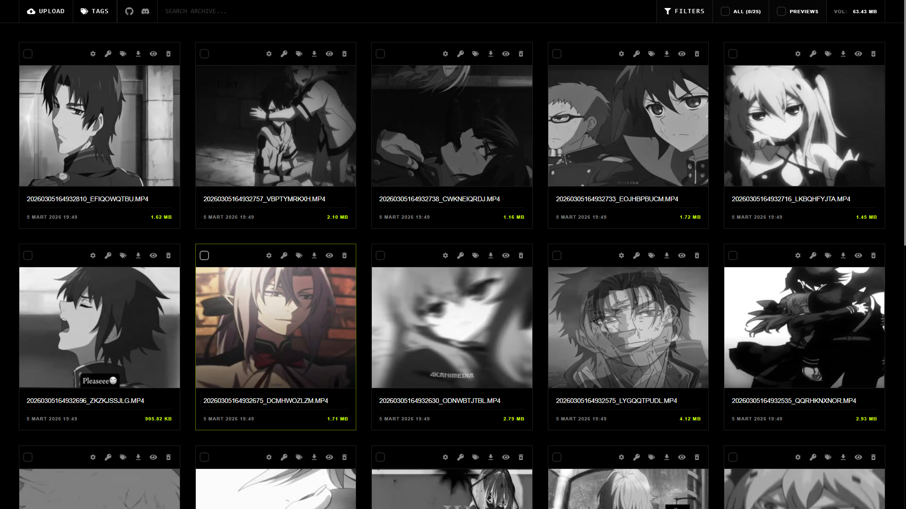
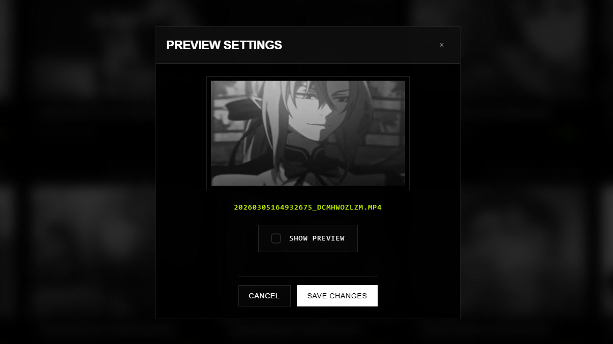
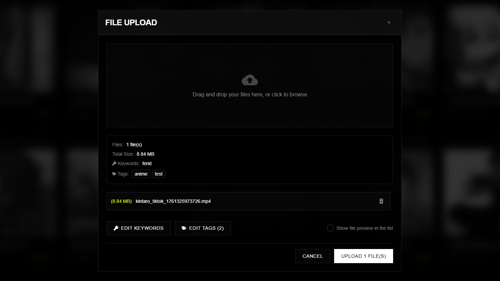
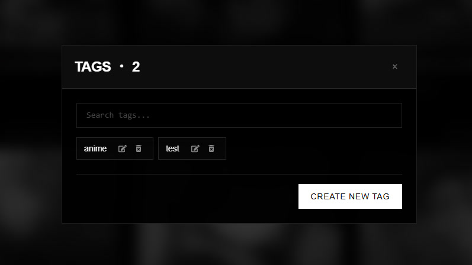

<a href="README.md">
  
</a>
<a href="README-TR.md">
  
</a>

  <br />
  <br />

<div align="center">
  
  <br />
  <br />

  <p>
     A self-hosted app to upload, tag and filter your files locally.
  </p>


  <p>
    <a href="#about">About</a> •
    <a href="#features">Features</a> •
    <a href="#tech">Tech</a> •
    <a href="#setup">Setup</a> •
    <a href="#gallery">Gallery</a> •
    <a href="#license">License</a>
  </p>

  <br />
  <br />
</div>

## <a id="about"></a> 📋 About

**File Manager** is a self-hosted file management app with a dark, cyberpunk-inspired interface. Your files are stored on your own computer and their details are kept in a SQLite database, so no cloud service or external database is needed. You can upload any type of file, organize it with tags and keywords, and find it quickly with filters.

## <a id="features"></a> ✨ Features

- **File upload**: Upload multiple files at once by dragging them or choosing them, and add tags and keywords while uploading.
- **Tags**: Create, rename and delete tags, and assign one or more tags to any file.
- **Keywords**: Add comma-separated keywords to files and edit them later.
- **Filtering**: Search files by keyword and filter them by tags, matching any or all of the selected tags.
- **Thumbnails**: Thumbnails are created automatically for images and videos.
- **Preview**: Open supported files such as images, videos, audio, PDF and text files directly in the browser.
- **Preview settings**: Hide the thumbnail of a file, or show all thumbnails at once.
- **Download**: Download a single file, or download the selected files as a `.zip` archive.
- **Bulk actions**: Select all visible files and delete them together after a confirmation.
- **Storage info**: See the total size of all files, the filtered files and the selected files.
- **Load more**: Files are shown 50 at a time with a button to load more.

## <a id="tech"></a> 🛠️ Tech

`Node.js` · `Express` · `SQLite` · `better-sqlite3` · `Multer` · `Sharp` · `FFmpeg` · `Archiver` · `React` · `Vite` · `Tailwind CSS` · `Framer Motion` · `Axios` · `React Icons`

## <a id="setup"></a> 🚀 Setup

### Requirements

- **Node.js**

### Step-by-Step Installation

1. **Clone the repository**

   ```bash
   git clone https://github.com/xkintaro/file-manager.git
   cd file-manager
   ```

2. **Install dependencies**

   ```bash
   cd backend
   npm install
   cd ../frontend
   npm install
   ```

   On Windows you can run `install-dependencies.bat` instead.

3. **Set the addresses**

   Replace `192.168.1.100` in `backend/.env` and `frontend/.env` with `localhost` or your computer's local IP address:

   ```env
   # backend/.env
   BACKEND_PORT=5034
   FRONTEND_URL=http://localhost:5033

   # frontend/.env
   VITE_API_URL=http://localhost:5034
   VITE_FRONTEND_PORT=5033
   ```

4. **Start the backend and the frontend**

   ```bash
   # Terminal 1
   cd backend
   node src/server.js

   # Terminal 2
   cd frontend
   npm run dev
   ```

   On Windows you can run `run.bat` instead.

Open the app at [http://localhost:5033](http://localhost:5033).

## <a id="gallery"></a> 🖼️ Gallery









## <a id="license"></a> 📄 License

This project is licensed under the MIT License. See the [LICENSE](LICENSE) file for details.

#

<p align="center">
  <sub>❤️ Developed by "Mustafa TAŞAL" (kintaro)</sub>
</p>
